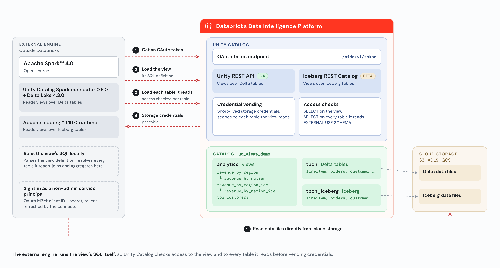

# Runbook: Query Unity Catalog Views from External Engines (demo)

This runbook walks you through the demo end to end, from a local folder against your Databricks workspace on AWS: set up your machine, deploy the demo, run it, and remove everything afterwards. Allow about 15–20 minutes.



## At a glance

| Phase | Command | Time | Result |
| :---- | :---- | :---- | :---- |
| 0. One-time setup | Get the code, create a venv, log in | 5 min | A working folder with a clean Python environment and a Databricks CLI profile |
| 1. Deploy | `python deploy.py -p <profile>` | 3–4 min | Warehouse, catalog, TPC-H tables, views, reader service principal, grants |
| 2. Run the demo | `python run.py -p <profile>` | 5–8 min | Spark on your machine queries the views; governance; Iceberg views |
| 3. Destroy | `python destroy.py -p <profile>` | 1–2 min | Everything the demo created is removed |

All three scripts are interactive. They show a numbered agenda and a progress bar, show every SQL statement before running it, and wait for you to press **Enter** between steps.

**How to read the commands.** Two values are yours to choose:

- `DEMO_DIR`: the folder you run the demo from. Use a normal local folder, not one synced by Google Drive, OneDrive or Dropbox.
- `PROFILE`: your Databricks CLI profile for the workspace.

Set them once per terminal, and every block below then copies and pastes as is:

```sh
export DEMO_DIR=<path-to-this-folder>
export PROFILE=<your-cli-profile>
```

## Before you start

| Requirement | How to check |
| :---- | :---- |
| A Databricks workspace on AWS with Unity Catalog | Open the workspace URL |
| External data access enabled on the metastore | Catalog > gear icon > Metastore > Details > External data access |
| Beta preview **External Access to Views via Iceberg REST Catalog** turned on (needed only for the Iceberg views) | Settings > Previews, search "external" |
| Workspace admin (needed to create the reader service principal) | You're in the workspace `admins` group |
| Databricks CLI installed | `databricks --version` |
| Python 3.10+ and Java 17 | `python3 --version`, `java -version` |

## Phase 0: One-time setup

### 0.1 Get the code

Clone only this folder of the repository:

```sh
git clone --filter=blob:none --sparse https://github.com/databricks-solutions/databricks-blogposts.git
cd databricks-blogposts
git sparse-checkout set 2026-10-how-to-query-unity-catalog-views-from-external-engines
export DEMO_DIR="$PWD/2026-10-how-to-query-unity-catalog-views-from-external-engines"
export PROFILE=<your-cli-profile>
ls -a "$DEMO_DIR"
```

**You should see:** `README.md`, `RUNBOOK.md`, `_common.py`, `_ui.py`, `deploy.py`, `run.py`, `destroy.py`, `requirements.txt`, `.env.example`, `.gitignore`, and an `images/` folder.

### 0.2 Create a clean virtual environment

```sh
cd "$DEMO_DIR"
python3 -m venv .venv
source .venv/bin/activate
pip install -r requirements.txt
```

**You should see:** `pyspark 4.0.1` and `databricks-sdk` 0.153 or later installed. Always run the scripts from this venv. If you run one from another Python (for example a global Python with an old SDK or `databricks-connect`), it stops at once with "This Python environment can't run the demo" and tells you how to fix it.

### 0.3 Log in to the workspace with OAuth

```sh
databricks auth login --host https://<your-workspace-url> --profile "$PROFILE"
databricks current-user me -p "$PROFILE"
```

A browser window opens. Sign in, then come back to the terminal. **You should see:** `Profile <your-cli-profile> was successfully saved`, then your user details.

### 0.4 Optional settings (.env)

The scripts read optional settings from `$DEMO_DIR/.env`. Create it from the template:

```sh
cd "$DEMO_DIR"
[ -f .env ] || cp .env.example .env
```

All settings are optional:

| Setting | Default | Use |
| :---- | :---- | :---- |
| `UC_CATALOG` | `uc_views_demo` | Catalog the demo creates |
| `TPCH_FROM` / `TPCH_TO` | Q1 1998 | Date range of orders and line items copied from `samples.tpch` |
| `UC_MANAGED_LOCATION` | — | Only if the metastore has no root storage |
| `DATABRICKS_WAREHOUSE_ID` | — | Use an existing SQL warehouse instead of creating one. destroy.py keeps it and removes only the reader's access |
| `SPARK_REPOSITORIES` | — | A Maven mirror, if your network blocks Maven Central |

`.env` is gitignored; keep it local.

### Every new terminal

```sh
export DEMO_DIR=<path-to-this-folder>
export PROFILE=<your-cli-profile>
cd "$DEMO_DIR" && source .venv/bin/activate
```

## Phase 1: Deploy

```sh
cd "$DEMO_DIR" && source .venv/bin/activate
python deploy.py -p "$PROFILE"
```

Press **Enter** to move through the 9 steps:

| Step | What happens | What you should see |
| :---- | :---- | :---- |
| 1. Connect and check prerequisites | Reads your user, the metastore and your admin status | A Workspace panel showing Workspace admin ✓ and External data access enabled ✓ |
| 2. Create the SQL warehouse | Finds or creates the 2X-Small serverless warehouse `uc-views-demo` (auto-stops after 10 min) | "Warehouse … is running, and the built-in TPC-H sample data is available." |
| 3. Create the catalog and schemas | `uc_views_demo` with `tpch`, `tpch_iceberg` and `analytics` | The SQL statements, plus a Catalog Explorer link |
| 4. Copy TPC-H into Delta tables | CTAS from `samples.tpch`; orders and line items limited to Q1 1998 | Row counts: region 5, nation 25, customer 750000, orders 281617, lineitem 1124614 |
| 5. Copy TPC-H into Iceberg tables | Managed Iceberg copies of the same 5 tables | "5 managed Iceberg tables created …" |
| 6. Create the views | `revenue_by_nation`, `revenue_by_region` (a view on a view), `top_customers`, `revenue_by_nation_ice`, `revenue_by_region_ice` (an Iceberg view on a view) | The view SQL, plus a link to the views |
| 7. Create the external reader | Finds or creates the service principal `uc-views-demo-reader` (non-admin, workspace-access entitlement) and creates an OAuth secret | An External reader panel with the application (client) ID. The secret is saved to `$DEMO_DIR/.demo_state.<profile>.env` (only you can read it; never share or commit it) |
| 8. Grant the reader access | `USE CATALOG`; `USE SCHEMA`, `SELECT` and `EXTERNAL USE SCHEMA` on the 3 schemas; `CAN USE` on the warehouse | The GRANT statements |
| 9. Verify the deployment | Lists everything and checks the Iceberg REST Catalog for view support | 15 objects, and **Views via Iceberg REST Catalog: available ✓ (Beta enabled)** |

Rerunning `deploy.py` is safe: tables and views are replaced, and the service principal is reused.

## Phase 2: Run the demo

```sh
cd "$DEMO_DIR" && source .venv/bin/activate
python run.py -p "$PROFILE"
```

Open source Apache Spark runs on your machine and authenticates as the service principal with OAuth M2M. The first Spark start can take about a minute while it downloads the connector jars.

| Step | What happens | What you should see |
| :---- | :---- | :---- |
| 1. Check the deployment | Confirms the reader, warehouse and views exist | A Demo panel. If something's missing, it tells you to run deploy.py |
| 2. Start Spark (Unity REST API) | Unity Catalog Spark connector 0.6.0 + Delta 4.3.0, `auth.type=oauth` | A runtime panel with the live Spark config (the secret shown as `<hidden>`) |
| 3. Query a view built on another view | `SELECT * FROM analytics.revenue_by_region` | ASIA 56843 orders 8,250,496,500.50 · EUROPE 8,201,206,555.67 · MIDDLE EAST 8,198,150,600.66 · AFRICA 8,117,132,144.18 · AMERICA 8,092,242,554.94 |
| 4. Filter a view | `revenue_by_nation WHERE region = 'ASIA'` | INDONESIA 1,682,265,357.85 at the top, then INDIA, CHINA, JAPAN, VIETNAM |
| 5. Join a view with a table | `top_customers` joined with `tpch.customer` | Customer#000419993, SAUDI ARABIA, 1,320,114.72 at the top |
| 6. Governance: revoke SELECT on the tables | `REVOKE SELECT ON SCHEMA uc_views_demo.tpch FROM <reader>`, then the same query from a fresh Spark session | 🔒 `Failed to load table uc_views_demo.tpch.lineitem (HTTP 403) … PermissionDeniedException` |
| 7. Governance: the same reader in Databricks SQL | The same query on the SQL warehouse, as the reader | The same 5 rows. "It works here. Databricks compute evaluates a view with its owner's privileges…" |
| 8. Governance: grant SELECT back | `GRANT SELECT ON SCHEMA uc_views_demo.tpch TO <reader>`, then query again from Spark | The same 5 rows. "Access restored…" |
| 9. Start Spark (Iceberg REST Catalog) | The plain Apache Iceberg 1.10.0 runtime, `rest.auth.type=oauth2` | A runtime panel showing the iceberg-rest URI and vended-credentials |
| 10. Query a view over Iceberg tables | `SELECT * FROM analytics.revenue_by_nation_ice … LIMIT 10` | 10 rows: ASIA INDONESIA 1,682,265,357.85 at the top, then MIDDLE EAST IRAQ, EUROPE GERMANY… |
| 11. Query an Iceberg view built on another view | `SELECT * FROM analytics.revenue_by_region_ice` (it reads `revenue_by_nation_ice`) | The same 5 rows as step 3: ASIA 56843 orders 8,250,496,500.50 at the top. Both views are resolved through the Iceberg REST Catalog |

The run ends with a recap. Every step is green-ticked, or the failed steps are marked ✗ and run.py exits with status 1. You can run `run.py` again as many times as you like. The numbers above are for the default Q1 1998 data.

## Phase 3: Destroy

```sh
cd "$DEMO_DIR" && source .venv/bin/activate
python destroy.py -p "$PROFILE"
```

| Step | What happens | What you should see |
| :---- | :---- | :---- |
| 1. Connect | Reads the workspace and you | A Workspace panel |
| 2. Review | Lists the catalog's 15 tables and views, the service principal, the local secret file and the warehouse | A "Will be removed" panel, then the prompt **Type 'uc_views_demo' to delete all of the above** |
| 3. Drop the catalog | `DROP CATALOG uc_views_demo CASCADE` | "Catalog uc_views_demo dropped…" |
| 4. Service principal and local secret | Revokes all its OAuth secrets, tries to delete it, and deletes `$DEMO_DIR/.demo_state.<profile>.env` | "Revoked 1 OAuth secret(s)…". In some workspaces, also a note that the service principal couldn't be deleted (see Troubleshooting) |
| 5. Delete the warehouse | Deletes `uc-views-demo` | "Warehouse uc-views-demo deleted." |

To start over, run Phase 1 again.

## Hands-free and debugging options

| Option | Use |
| :---- | :---- |
| `DEMO_AUTO=1 python deploy.py -p "$PROFILE"` | No Enter prompts. Works for all three scripts |
| `DEMO_AUTO=1 python destroy.py -p "$PROFILE" --yes` | Hands-free teardown (`--yes` is required with DEMO_AUTO) |
| `DEMO_VERBOSE=1 python run.py -p "$PROFILE"` | Shows Spark's startup logs (Maven downloads, warnings) |
| `DEMO_PAGE=0` | Turns off the scroll animation between steps |

## Troubleshooting

| Symptom | Cause | Fix |
| :---- | :---- | :---- |
| "This Python environment can't run the demo" | Wrong Python: old SDK, missing PySpark, or `databricks-connect` installed | `cd "$DEMO_DIR" && source .venv/bin/activate` (see 0.2) |
| "A new access token could not be retrieved because the refresh token is invalid" | The OAuth login for the profile expired | Run the login in 0.3 again |
| `$DEMO_DIR` is empty or commands fail with "No such file" | A new terminal without the variables | Run the "Every new terminal" block |
| Spark start fails with `unresolved dependency` / `Connection refused` | Maven Central is blocked on your network | Set `SPARK_REPOSITORIES` in `$DEMO_DIR/.env` to a Maven mirror (see 0.4); rerun with `DEMO_VERBOSE=1` to see the downloads |
| `Unable to locate a Java Runtime` or Java errors | Java 17 isn't the active JDK | Point `JAVA_HOME` at a Java 17 install (on macOS: `export JAVA_HOME=$(/usr/libexec/java_home -v 17)`) |
| run.py: "The demo isn't deployed" | deploy.py hasn't run in this folder, or destroy.py has. The reader's secret lives in `$DEMO_DIR`, so a deploy from another folder doesn't count | `python deploy.py -p "$PROFILE"` from `$DEMO_DIR` |
| Step 10: "not an Iceberg compatible table" | The Iceberg views Beta is off | Settings > Previews: turn on "External Access to Views via Iceberg REST Catalog", wait a few minutes, rerun |
| Step 6: "Unexpected: the query succeeded" | The reader has SELECT on tpch some other way (a group or catalog grant) or admin rights | Use a non-admin service principal with only the grants deploy.py makes |
| destroy.py: "The workspace didn't delete the service principal" | The workspace uses identity federation; the service principal stays visible through account-level groups | Expected. Its secrets are revoked, and its grants and warehouse access are gone. An account admin can delete `uc-views-demo-reader` in the account console under User management > Service principals |
| deploy.py stops at step 1: "Creating the reader service principal needs workspace admin" | You aren't a workspace admin in this workspace | Ask a workspace admin to run deploy.py |
| deploy.py: CREATE CATALOG fails about storage | The metastore has no root storage | Set `UC_MANAGED_LOCATION` in `.env` to a path covered by an external location |
| The first warehouse query is slow | The serverless warehouse is starting | Wait; the spinner keeps going until it's ready |

## What the demo creates

| Object | Name | Removed by destroy.py |
| :---- | :---- | :---- |
| SQL warehouse | `uc-views-demo` (2X-Small serverless) | Yes. A warehouse pinned with `DATABRICKS_WAREHOUSE_ID` is kept, and only the reader's access to it is removed |
| Catalog | `uc_views_demo` (schemas `tpch`, `tpch_iceberg`, `analytics`) | Yes (CASCADE) |
| Tables | `region`, `nation`, `customer`, `orders`, `lineitem`, as Delta and as Iceberg | Yes, with the catalog |
| Views | `revenue_by_nation`, `revenue_by_region`, `top_customers`, `revenue_by_nation_ice`, `revenue_by_region_ice` | Yes, with the catalog |
| Service principal | `uc-views-demo-reader` | Secrets revoked; deleted where the workspace allows |
| Local secret file | `$DEMO_DIR/.demo_state.<profile>.env` | Yes |
| Local files | `$DEMO_DIR/.venv`, `$DEMO_DIR/.env` | No; delete them yourself when you're done |

## Reference

- Code details: [README.md](README.md)
- Docs: [External access to views](https://docs.databricks.com/aws/en/external-access/views)
