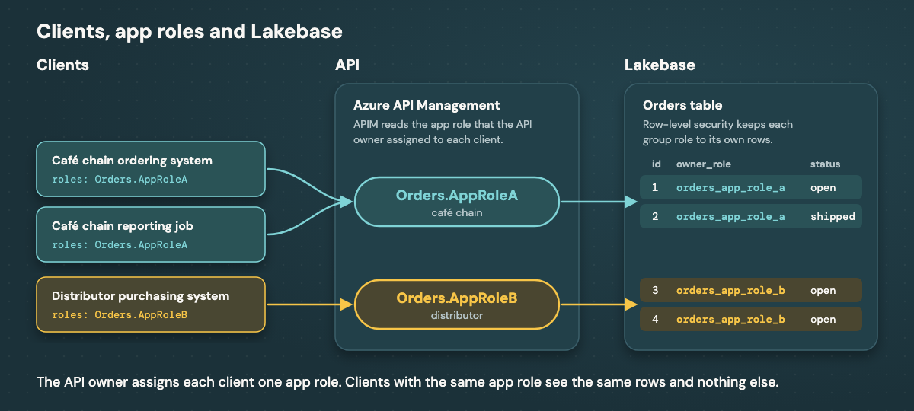
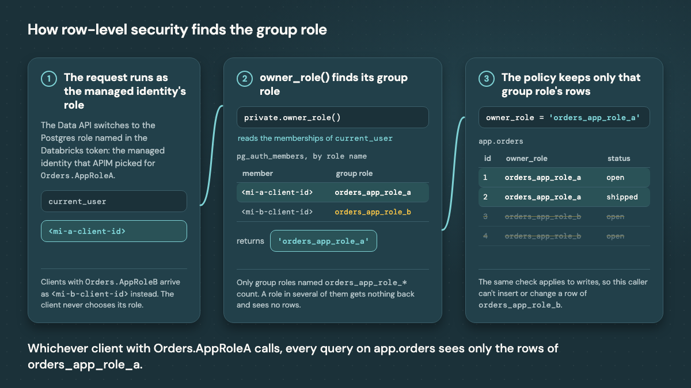

# Serving the Lakebase Data API through Azure API Management

Terraform, APIM policies and SQL for putting [Azure API Management](https://learn.microsoft.com/en-us/azure/api-management/api-management-key-concepts) (APIM) in front of the [Lakebase Data API](https://learn.microsoft.com/en-us/azure/databricks/oltp/projects/data-api), so clients outside Databricks can use the Entra identities they already have, and each client sees only the rows its app role allows. It's the companion code for the blog post *Serving the Lakebase Data API Through Azure API Management*.

APIM gets its Databricks tokens with no stored secret: it exchanges a managed identity's Entra token for a Databricks token through [workload identity federation](https://learn.microsoft.com/en-us/azure/databricks/dev-tools/auth/oauth-federation). For app role access, the API owner assigns each client one [app role](https://learn.microsoft.com/en-us/entra/identity-platform/howto-add-app-roles-in-apps) on the gateway app registration (`Orders.AppRoleA` or `Orders.AppRoleB`). Each app role has its own managed identity, whose Postgres role is the only member of a group role such as `orders_app_role_a`, and [row-level security](https://www.postgresql.org/docs/current/ddl-rowsecurity.html) keeps each group role to its own rows.




## What gets deployed

Three APIs on one APIM instance, each behind a toggle in `terraform.tfvars`:

| Path | Toggle | Callers authenticate with | APIM reaches Lakebase as |
|---|---|---|---|
| `/lakebase` | `enable_mi_api` | APIM subscription key | One shared managed identity, through token exchange |
| `/lakebase-rls` | `enable_app_role_rls` | Entra token for the gateway app registration, carrying an `Orders.AppRole<X>` app role | The app role's own managed identity, through token exchange, with row-level security |
| `/lakebase-s` | `enable_secret_alternative` | APIM subscription key | The shared identity's service principal, with a stored Databricks OAuth secret |

Terraform creates, in a new resource group: the APIM instance (Basic v2), the managed identities, their Databricks service principals with federation policies and workspace access, and, for `/lakebase-rls`, the gateway app registration with the app roles `Orders.AppRoleA` and `Orders.AppRoleB` plus a sample client app for each. The SQL creates a shared product catalog, the Postgres roles, a group role per app role, and the orders under row-level security.

The repo doesn't create the Databricks workspace or the Lakebase project. You bring both.

## Before you start

You need:

- **Tools:** [Terraform](https://developer.hashicorp.com/terraform/install) 1.5 or later, the [Azure CLI](https://learn.microsoft.com/en-us/cli/azure/install-azure-cli), the [Databricks CLI](https://learn.microsoft.com/en-us/azure/databricks/dev-tools/cli/install) 0.299 or later (for the `postgres` commands), `psql` and `jq`.
- **Azure:** permission to create a resource group, managed identities and an APIM instance in the subscription.
- **Entra ID:** permission to create app registrations (for `/lakebase-rls`).
- **Databricks:** account admin on the Databricks account (to add service principals, federation policies and workspace assignments), and ownership of the Lakebase project (to create roles and run the SQL).
- **An Azure Databricks workspace** with a **[Lakebase Autoscaling project](https://learn.microsoft.com/en-us/azure/databricks/oltp/projects/)**, in a region where Lakebase Autoscaling is available, and the **[Data API](https://learn.microsoft.com/en-us/azure/databricks/oltp/projects/data-api) turned on** for the database you want to serve.
- **Exposed schemas:** the Data API serves only the schemas listed under exposed schemas on the project's Data API page. Keep `public`, and for `/lakebase-rls` add `app` before you run `scripts/10-postgres-setup.sh`. Don't expose `private`, which holds the `owner_role()` lookup.

From the workspace and the project, note:

| Value | Where to find it |
|---|---|
| Workspace ID and URL | The workspace URL, `https://adb-<workspace-id>.<n>.azuredatabricks.net` |
| Data API URL | The Lakebase project's Data API page |
| Endpoint name | `databricks postgres list-endpoints projects/<project>/branches/<branch>`, the `name` field |
| Database name | `databricks postgres list-databases projects/<project>/branches/<branch>`, the `name` field |

## Set it up

Sign in, and fill in the variables:

```bash
az login --tenant <tenant-id>
cd terraform
cp terraform.tfvars.example terraform.tfvars   # fill in the values from the table above
```

Deploy. APIM Basic v2 takes a few minutes:

```bash
terraform init
terraform apply
```

Create the catalog, the Postgres roles and, for `/lakebase-rls`, the group roles and the app schema with row-level security:

```bash
cd ..
./scripts/10-postgres-setup.sh
```

Run the tests:

```bash
./scripts/20-test.sh
```

The test script calls each deployed API and prints the status code, the app role, and whether the Databricks token came from the cache or a fresh exchange. Response bodies are saved to `results/`, and client tokens and secrets stay in memory.

`demo/crud-demo.sh` walks through reads, writes and function calls on `/lakebase` with curl.

## Try an app role call by hand

Get a token as the sample client with `Orders.AppRoleA`, and call the app role API with it:

```bash
cd terraform
TENANT_ID=$(terraform output -raw tenant_id)
GW_APP_ID=$(terraform output -raw gateway_app_id)
CLIENT_ID=$(terraform output -json client_app_ids | jq -r .a)
CLIENT_SECRET=$(terraform output -json client_secrets | jq -r .a)
GW=$(terraform output -raw apim_gateway_url)/lakebase-rls

TOKEN=$(curl -s "https://login.microsoftonline.com/$TENANT_ID/oauth2/v2.0/token" \
  -d grant_type=client_credentials -d client_id="$CLIENT_ID" --data-urlencode client_secret="$CLIENT_SECRET" \
  -d scope="api://$GW_APP_ID/.default" | jq -r .access_token)

curl -s -H "Authorization: Bearer $TOKEN" "$GW/app/orders" | jq
```

The client gets only the orders of `orders_app_role_a`. Use `.b` instead of `.a` for the client with `Orders.AppRoleB`.


## How row-level security finds the group role

The Data API runs each request as the Postgres role named in the Databricks token, which for `/lakebase-rls` is the app role's managed identity. `private.owner_role()` finds the group role that role belongs to in `pg_auth_members`, and the policy on each table keeps only that group role's rows:



See `sql/03-app-role-rls.sql` for the group roles, the tables, the lookup function and the policies.

## Troubleshooting

| Symptom | Likely cause |
|---|---|
| `AADSTS501051` when a client asks Entra ID for a token | The client app has no app role on the gateway app registration, which requires one. Assign an `Orders.AppRole<X>` app role |
| `401` from APIM on `/lakebase-rls` with a token that looks valid | The token's audience isn't `api://<gateway-app-id>`, or it comes from another Entra directory |
| `403` with `no_app_role` | The client's token carries no `Orders.AppRole*` app role, or more than one |
| `500` with `apim_managed_identity_token_failed` | The managed identity isn't attached to APIM, or a named value holds its object ID instead of its client ID |
| `502` with `lakebase_token_exchange_failed` and `invalid_grant` | The federation policy's subject isn't the managed identity's object ID, or an audience is missing |
| `400` from the Data API with a message about the token, such as "jwk not found" | The Data API only accepts Databricks tokens. Check that the managed identity's service principal is assigned to the workspace |
| `403`, code `42501`, "permission denied to set role" | The role isn't granted to `authenticator`. Re-run `scripts/10-postgres-setup.sh` |
| `403`, code `42501`, "permission denied for table" | The role has no grant on that table. `public.supplier_costs` returns this on purpose |
| `406`, code `PGRST106` | The schema isn't in the Data API's exposed schemas |
| `403`, "permission denied for schema app" on `/lakebase-rls` | The managed identity's role isn't a member of its group role, which holds the grants. Re-run `scripts/10-postgres-setup.sh` after any change to the managed identities |
| `200` with an empty list for every read on `/lakebase-rls` | The managed identity's role belongs to more than one `orders_app_role_*` group role, so `private.owner_role()` returns nothing |

## Cost and teardown

APIM Basic v2 costs about $150 a month while it runs. Tear the deployment down when you're done:

```bash
./scripts/90-teardown.sh
```

It removes everything Terraform created. Your workspace and Lakebase project stay, along with the sample schemas, which you can drop with `DROP SCHEMA app CASCADE; DROP SCHEMA private CASCADE;` and `DROP TABLE public.products CASCADE;`, and the group roles, which you can drop with `DROP OWNED BY orders_app_role_a, orders_app_role_b; DROP ROLE orders_app_role_a, orders_app_role_b;`.

## Adding an app role

The app role list is fixed at `a` and `b` (`terraform/variables.tf`). A new app role needs:

- its value in the `app_roles` list, which adds the app role, a managed identity with its service principal and federation policy, and a named value in APIM;
- a `<when>` branch for its managed identity in `policies/lakebase-data-api-app-role-rls.xml`;
- its group role, membership and grants in `sql/03-app-role-rls.sql`.

A new client with an existing app role needs no change here, only an app role assignment on the gateway app registration. For thousands of app roles, or isolation per end user, see [docs/client-identity-and-rls.md](docs/client-identity-and-rls.md).

## Production notes

- The sample client apps use client secrets, which keeps the curl examples short. Production clients should use a certificate, a federated credential or, if they run in Azure, their own managed identity.
- For `/lakebase-s`, keep the Databricks OAuth secret in Azure Key Vault and reference it from a Key Vault-backed named value.
- Terraform state holds the sample client secrets and the Databricks OAuth secret. Use a remote backend with restricted access.

## Folder layout

| Path | Contents |
|---|---|
| `terraform/` | APIM, managed identities, Databricks service principals and federation policies, Entra app registrations |
| `policies/` | APIM policies for the three APIs |
| `sql/` | The catalog, the shared identity's role, and the group roles and app schema with row-level security |
| `scripts/` | Postgres setup, tests and teardown |
| `demo/` | A curl walkthrough of `/lakebase` |
| `docs/` | Design notes on client identity and RLS options, and the figures |

## Licenses

This folder is covered by the Databricks License in the repository root ([LICENSE](../LICENSE) and [NOTICE](../NOTICE)). It bundles no third-party code. Terraform downloads these providers at `terraform init`, each under its own license:

| Provider | License |
|---|---|
| [hashicorp/azurerm](https://github.com/hashicorp/terraform-provider-azurerm) | MPL-2.0 |
| [hashicorp/azuread](https://github.com/hashicorp/terraform-provider-azuread) | MPL-2.0 |
| [hashicorp/random](https://github.com/hashicorp/terraform-provider-random) | MPL-2.0 |
| [hashicorp/time](https://github.com/hashicorp/terraform-provider-time) | MPL-2.0 |
| [databricks/databricks](https://github.com/databricks/terraform-provider-databricks) | Databricks License |
