# AI/BI dashboard performance benchmark

What actually makes a Databricks AI/BI (Lakeview) dashboard load fast? This repo rebuilds a typical Tableau-style
"Sales Performance | Overview" dashboard on AI/BI, on 10M rows of synthetic data, and measures common performance
levers **on their own** (each alone on the baseline) and **stacked** (cumulative). The baseline is what a careful
migration would start from: liquid-clustered star schema, all logic in a parameterized Unity Catalog metric view, 12
charts and 16 filters on the landing page. Every variant was measured 10 times, both as a pure query replay and in
the browser.

Stacked, the cold browser load went from **10.3 s to 1.0 s** (−91%). On its own: Lakehouse//RT −66%, pre-joined
table −55%, dropdowns from small tables −23%, materialized grain −22%, fewer widgets −20%. Liquid clustering itself
gave no gain at 10M rows.

Write-up: [`blog/blog_post.md`](blog/blog_post.md) (PDF: `blog/blog_post.pdf`). Full numbers, findings and method:
[`RESULTS.md`](RESULTS.md); raw runs: `results/`.

The first run (cumulative steps on an unclustered star schema with inline SQL, 9.4 s → 1.0 s) is archived on the
branch [`archive/first-run`](https://github.com/dbxorbey/aibibenchmark/tree/archive/first-run).

| Stacked step | What changes | Browser first load |
|---|---|---:|
| 0 Baseline | liquid-clustered star schema; datasets query a parameterized metric view; 12 charts and 16 filters on the landing page; dropdown values come from the joined fact data | 10.31 ± 1.45 s |
| 1 Pre-joined table | the metric view and the dropdowns read one denormalized table (no joins) | 4.67 ± 0.62 s |
| 2 Materialized grain | the metric view reads a materialized product × country × week grain (13x fewer rows) | 4.84 ± 0.63 s |
| 3 Fewer widgets on page 1 | only the main chart on the landing page; 11 charts move to a "Deep Dive" page | 3.91 ± 0.45 s |
| 4 Dropdowns from small tables | filter dropdowns no longer query the 10M-row table | 2.63 ± 0.38 s |
| 5 Lakehouse//RT | step 4 on a Lakehouse//RT warehouse | 0.96 ± 0.18 s |

## Variants

| Key | Variant | Change vs baseline |
|---|---|---|
| `l0_baseline` | Baseline | liquid-clustered star schema, metric view, 12 charts on page 1, dropdowns from the joined fact, PRO |
| `li1_prejoined` | Isolated 1 = Stacked 1 | metric view and dropdowns on the pre-joined wide table |
| `li2_matgrain` | Isolated 2 | metric view on the materialized grain, falls back to the star schema |
| `li3_fewwidgets` | Isolated 3 | only the main chart on page 1 |
| `li4_ignfilters` | Isolated 4 | dropdowns from tiny dims / static lists |
| `li5_lakehousert` | Isolated 5 | baseline on Lakehouse//RT |
| `ls2_matgrain` | Stacked 2 | stacked 1 + materialized grain (falls back to the wide table) |
| `ls3_fewwidgets` | Stacked 3 | + only the main chart on page 1 |
| `ls4_ignfilters` | Stacked 4 | + dropdowns from tiny dims |
| `ls5_lakehousert` | Stacked 5 | + Lakehouse//RT |
| `r_nolc` | Reference | baseline **without** liquid clustering (unclustered tables in `BENCH_SCHEMA`) |

Cluster keys: `fact_sales (week_id, country_id, brand_id)`, `wide_sales` and `agg_product_country_week`
`(week_idx, country_code, brand_name)`, dims on their primary key (`sql/04_clustered_tables.sql`, CTAS +
`OPTIMIZE FULL`).

## How it was measured

Both flows cycle through their steps (about 6 s per step). Each step names the file and lines that do the work.
For the full code of each step, open [`docs/measurement_flow.html`](docs/measurement_flow.html) locally:
it has the same two flows with play/pause, step navigation and the code panels.

**Browser benchmark**: Refresh after cache invalidation = first load; page navigation = subsequent load (dashboard cache)



**SQL replay benchmark**: all landing-page queries fired in parallel straight at the warehouse



## Repository layout

| Path | What it is |
|---|---|
| `config.py` | all settings, read from environment variables |
| `sql/00–03_*.sql` | schema, synthetic data generator (star schema, pre-joined wide table), unclustered |
| `sql/04_clustered_tables.sql` | liquid-clustered copies of all tables + the materialized grain, in `BENCH_SCHEMA_LC` |
| `sql/05_metric_views.sql` | metric view DDL, generated by `build.py` |
| `sql/90_*.sql`, `sql/91_*.sql` | new Delta versions on all tables (+ full MV refresh) for cold-load measurements |
| `build.py` | generates the dashboard JSON of every variant from the same SQL templates (`out/`) |
| `create_warehouses.py` | creates the PRO and Lakehouse//RT benchmark warehouses |
| `deploy.py` | creates/updates and publishes one dashboard per variant |
| `run_sql.py` | runs a `.sql` file on a warehouse, filling in `${catalog}` / `${schema}` / `${schema_lc}` |
| `bench.py` | replay benchmark: fires all landing-page queries in parallel and times them |
| `measure.js` | browser timing snippet (run in the published dashboard, e.g. via Chrome DevTools MCP) |
| `step.sh`, `record.sh`, `invalidate.sh` | browser runs: log one measurement, invalidate the caches for the next one |
| `report.py`, `server_side.py` | results tables (`results/summary.md`), warehouse-side check from `system.query.history` |
| `chart.py`, `blog_pdf.py` | blog charts (`blog/{isolated,stacked}_chart.*`) and blog PDF |
| `docs/` | measurement flow: `measurement_flow.html` (interactive) and the animated `*_flow.svg` used above |

## Running it

### 1. Prerequisites and configuration

* A Databricks workspace with Unity Catalog, serverless SQL and the Lakehouse//RT Beta (for `*_lakehousert`).
* Python 3.10+ and the [Databricks CLI](https://docs.databricks.com/dev-tools/cli/) authenticated against the
  workspace (`databricks auth login`). Google Chrome for the chart/PDF export and the browser measurements.

```bash
python -m venv .venv && source .venv/bin/activate
pip install -r requirements.txt

export DATABRICKS_CONFIG_PROFILE=<your-profile>   # optional, otherwise the default auth chain is used
export BENCH_CATALOG=<catalog>                    # must exist; default: main
export BENCH_SCHEMA=aibi_bench                    # generated data, unclustered (sql/00-03)
export BENCH_SCHEMA_LC=aibi_bench_lc              # liquid-clustered copies (sql/04); default: <BENCH_SCHEMA>_lc
```

### 2. Warehouses

```bash
python create_warehouses.py       # prints the two export lines below
export BENCH_WAREHOUSE_PRO=<id>   # serverless PRO, Small, exactly 1 cluster
export BENCH_WAREHOUSE_RT=<id>    # Lakehouse//RT, Small, exactly 1 cluster (*_lakehousert)
export BENCH_WAREHOUSE_SETUP=<id> # optional: separate warehouse for data generation / cache invalidation
```

Same size and no autoscaling on both, so the variants compare designs, not cluster counts.

### 3. Data, metric views, dashboards

```bash
python build.py                              # out/*.json + sql/05_metric_views.sql
for f in sql/0*.sql; do python run_sql.py "$f"; done
python bench.py l0_baseline --check          # correctness: print the main chart result
python deploy.py                             # 11 published dashboards (ids in out/dashboards.tsv)
```

### 4. Replay benchmark (pure query time)

```bash
python bench.py <variant> --runs 10          # one variant on its configured warehouse
python bench.py l0_baseline --warehouse rt   # any variant on another warehouse
```

*First load* disables the SQL result cache (`use_cached_result=false`); *subsequent load* enables it after one
priming run. Sessions are opened before the timer starts; one unmeasured full page load warms the warehouse (right
after a resume from auto-stop the first runs are about 2x slower). Results go to
`results/replay_<variant>_<warehouse>.json`; `--append` adds runs to an existing file. Run the PRO variants one after
another; the RT variants can run in parallel to them.

### 5. Browser benchmark (what a user sees)

1. Open each published dashboard once (warm-up, not recorded).
2. `./step.sh <variant>` invalidates the caches of the schema that variant reads.
3. Navigate to the dashboard in Chrome with the init script `performance.setResourceTimingBufferSize(10000)` and run
   `measure.js` in the page (e.g. Chrome DevTools MCP `evaluate_script`): it times the page navigation (subsequent
   load, dashboard cache), then clicks Refresh and times it until the last `lakeview-query` response (first load).
4. `./step.sh <next_variant> <variant> <run> <first_s> <subsequent_s>` logs the run to `results/browser_runs.jsonl`
   and prepares the next one. Interleave all dashboards round-robin, 10 rounds.

Gotchas: publishing pre-warms the dashboard cache, and that cache ignores table-property commits, so use Refresh
after `invalidate.sh` for cold timings. `lakeview-query` long-poll requests take ~5 s, so the script waits for 10 s
without new requests.

### 6. Report and charts

```bash
python report.py                             # results/browser_<variant>.json + results/summary.md
python server_side.py --since <UTC start of round 1>   # PRO only, results/server_side.json
python chart.py && python blog_pdf.py        # blog/{isolated,stacked}_chart.html + .svg, blog/blog_post.pdf
```

### Cleanup

Delete the two warehouses (`databricks warehouses delete <id>`), drop both schemas and trash the dashboards (ids in
`out/dashboards.tsv`).

## Data model (10M rows, synthetic)

| Table | Rows | Content |
|---|---:|---|
| `fact_sales` | 10,000,000 | one row per product sold to a customer in a fiscal week; `rating_value` (NULL = not rated, ~36% response), `rating_scale_used` (4-star until 2026-W01, 5-star from 2026-W02), `is_flagged` |
| `dim_customer` | 2,000,000 | country, loyalty group |
| `dim_product` | 4,000 | product type, new/repeat, category |
| `dim_week` | 146 | fiscal week / month / quarter / year (2024-W01 … 2026-W42) |
| `dim_country` | 16 | country → country group |
| `dim_brand` | 4 | Brand A–D |
| `dim_pack_size` | 4 | packs of 2/3/4/6 |
| `wide_sales` | 10,000,000 | everything pre-joined |
| `agg_product_country_week` (materialized view, LC schema only) | ~772k | product × country × brand × week × flag grain |
| `mv_sales_performance_star`, `mv_sales_performance`, `mv_sales_performance_agg`, `mv_sales_performance_agg_star` (metric views) | – | on the star schema, the wide table, the grain with fallback to the wide table / star schema |

### Metrics and LOD logic

All metrics use three levels of detail, the same structure Tableau `{FIXED}` expressions produce:

1. **Product** `{FIXED period, split, country, product}`: average score (with / without flagged sales), ratings,
   1s, 2s, units sold.
2. **Country** `{FIXED period, split, country}`: weighted product rating (product averages weighted by units sold),
   average product rating, share of 1s / 2s, response rate, units sold, count of products, hit rate.
3. **Split value** (e.g. country group): Σ country metric / COUNT(DISTINCT country), with the denominator computed on
   the fly after all filters.

All 16 filters are dashboard parameters passed to the metric view (`size(:p) = 0 OR array_contains(:p, col)` for
multi-selects), because the LOD logic pre-aggregates before the split.

## Caveats

Synthetic data modelled on a real dashboard; the values are not real business numbers. One Small cluster without
autoscaling; larger data or more users will shift the absolute numbers. Lakehouse//RT is in Beta; its first query after
idling takes about 2 s, and its queries did not show up in `system.query.history` at the time of testing. If the
workspace uses an IP access list, keep the client IP stable during long runs; a blocked IP makes the SQL connector
retry for 15 minutes before it fails.
