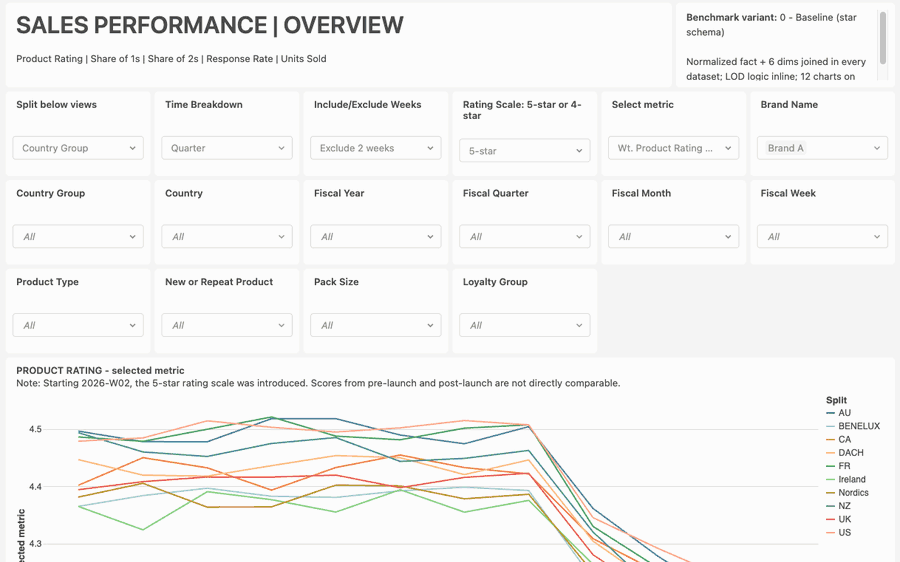
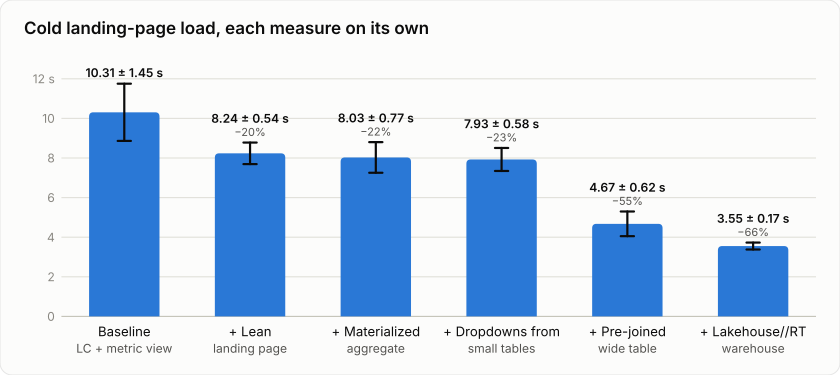
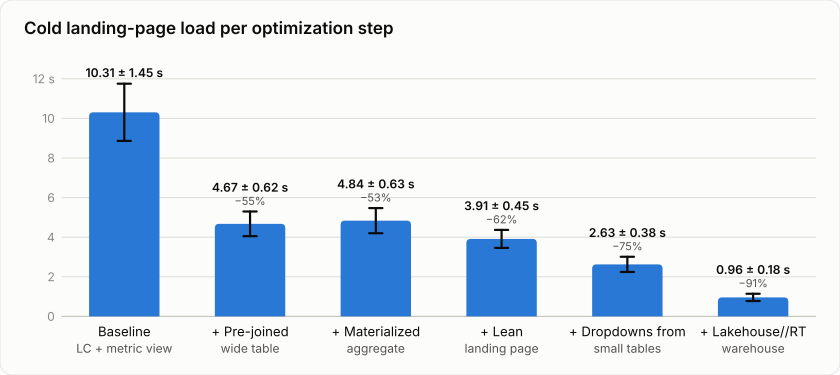

# What really makes an AI/BI dashboard fast? Every lever on its own, then all of them together

*Five performance techniques for Databricks AI/BI dashboards, 10 runs each: first in isolation, then stacked*

A slow dashboard rarely gets a bug ticket. People just stop opening it and go back to their spreadsheet exports. When
teams move their reporting to Databricks AI/BI, the first question I hear is "will it be fast?" The second one is "and
if not, what do we change?"

There is plenty of advice for the second question: pre-join your data, use fewer widgets, aggregate, use a faster
warehouse. What I could not find were numbers. How much does each of these actually buy you, and how far do you get
when you combine them?

So I rebuilt a real customer dashboard on AI/BI and measured. I ran two experiments:

1. **Each lever on its own.** Take the baseline and apply exactly one technique.
2. **All levers stacked.** Apply the techniques one after another, each step keeping the previous ones.

## 🧪 The setup

The dashboard is a "Sales Performance | Overview" page with product ratings by country, brand and week.

*Scrolling through the dashboard's landing page: 16 filter widgets, the main "Product Rating" chart and the 11
secondary line charts below it. Synthetic data.*

- **Data:** a 10-million-row synthetic star schema in Unity Catalog. One fact table of product sales plus six
  dimensions (customers, products, weeks, countries, brands, pack sizes). Every chart needs joins. All tables use
  **liquid clustering** on the columns the dashboard filters and joins on.
- **Dashboard:** 16 filter widgets (5 single-select, 11 multi-select), all bound to dashboard parameters rather than
  field filters, and a main "Product Rating" chart with 11 more line charts on the landing page. The parameters filter
  at row level before aggregation. The metrics are level-of-detail (LOD) calculations with three aggregation levels, and
  the denominator is computed on the fly after filters. Each filter widget also runs its own query to populate its
  dropdown values.
- **Query layer:** every chart dataset queries a **Unity Catalog metric view with parameters** that holds the LOD
  logic. This is how I would build the dashboard as a governed starting point, so it is part of the baseline and of
  every variant.
- **Compute:** one serverless SQL warehouse (Small, a single cluster, no autoscaling), so I compare designs, not cluster
  counts. The Lakehouse//RT runs use an RT warehouse of the same size.
- **Two measurements, 10 runs each:**
  - **Replay** fires all of the landing page's queries in parallel straight at the warehouse. That is the pure query
    cost.
  - **Browser** opens the published dashboard in Chrome and times it until the last result arrives. That is what a
    user sees. All 11 dashboards ran round-robin in the same session.
- **First load vs subsequent load:** for the first load, all caches are invalidated (new Delta versions on every table
  and a full refresh of the materialized view), so every query really runs. I checked this in the query history: none
  of the measured first-load queries came from the result cache. The subsequent load is served from the dashboard
  cache.

The levers:

| Lever | What changes |
|---|---|
| Pre-joined wide table | the metric view and the dropdowns read one denormalized table instead of joining seven |
| Materialized aggregate | the metric view reads a materialized view at product × country × week grain (772k rows instead of 10M) |
| Lean landing page | only the main chart on page 1; the other 11 charts move to a "Deep Dive" page |
| Dropdowns from small tables | filter values come from tiny dimension tables or static lists instead of the 10M-row fact |
| Lakehouse//RT | the same dashboard on a Lakehouse//RT (real-time) warehouse |

## 🔬 Experiment 1: each lever on its own

Every variant is the baseline plus exactly one change.

*Browser first load of the baseline and of each lever applied alone to the baseline. Mean of 10 runs with all caches
invalidated; error bars and "±" are one standard deviation, % is the change vs the baseline. Serverless SQL warehouse
Small, last bar Lakehouse//RT Small. Liquid clustering and a metric view in every variant.*

| Lever (alone on the baseline) | Browser first load | Change (browser) | Replay first load | Change (replay) |
|---|---:|---:|---:|---:|
| Baseline | 10.31 ± 1.45 s | | 8.35 ± 0.54 s | |
| Lakehouse//RT warehouse | 3.55 ± 0.17 s | **−66% ± 2** | 3.15 ± 0.11 s | −62% ± 1 |
| Pre-joined wide table | 4.67 ± 0.62 s | **−55% ± 3** | 4.55 ± 0.58 s | −45% ± 2 |
| Dropdowns from small tables | 7.93 ± 0.58 s | **−23% ± 4** | 7.79 ± 0.54 s | −7% ± 3 |
| Materialized aggregate | 8.03 ± 0.77 s | **−22% ± 4** | 6.07 ± 0.42 s | −27% ± 2 |
| Lean landing page | 8.24 ± 0.54 s | **−20% ± 4** | 6.06 ± 1.06 s | −27% ± 4 |

Load times are mean ± standard deviation of 10 runs; changes are ± one standard error. All changes are significant
(Welch t-test against the baseline).

**Results:**

- **Lakehouse//RT had the biggest impact (−66%),** followed by the **pre-joined table (−55%).** Both make every query
  on the page cheaper: the RT engine runs each query faster, and the wide table removes the joins.
- **Feeding the dropdowns from small tables saved 23% in the browser, but only 7% in the replay.** In the baseline,
  each of the 16 dropdown queries joins seven tables over 10 million rows to list a few distinct values. It is also the
  simplest change of the five.
- **The materialized aggregate (−22%) and the lean landing page (−20%) gained about as much in the browser as the
  dropdowns.** Both only change the chart queries. The 16 dropdown queries stay the same and still take a large share
  of the page load.
- **Subsequent (cached) loads stayed between 2.2 and 2.7 s for all variants.** Most of that time is the dashboard app
  loading before the first query is sent. The levers affect the first load and every filter change, because new
  parameter values mean new, uncached queries.

## 🧱 Experiment 2: all levers stacked

The same levers, now applied one after another, each step keeping the previous ones.

*Browser first load per step, from 10.3 s to 1.0 s. Mean of 10 runs with all caches invalidated; error bars and "±"
are one standard deviation, % is the change vs the baseline. Serverless SQL warehouse Small, last bar Lakehouse//RT
Small. Liquid clustering and a metric view in every step.*

| Step (on top of the previous ones) | Browser first load | Change vs baseline (browser) | Replay first load | Change vs baseline (replay) |
|---|---:|---:|---:|---:|
| Baseline (star schema) | 10.31 ± 1.45 s | | 8.35 ± 0.54 s | |
| + Pre-joined wide table instead of a star schema | 4.67 ± 0.62 s | **−55% ± 3** | 4.55 ± 0.58 s | −45% ± 2 |
| + Materialized aggregate at chart grain | 4.84 ± 0.63 s | **−53% ± 3** | 3.81 ± 0.35 s | −54% ± 2 |
| + Only the main chart on the landing page | 3.91 ± 0.45 s | **−62% ± 2** | 2.11 ± 0.53 s | −75% ± 2 |
| + Filter dropdowns fed from small dimension tables | 2.63 ± 0.38 s | **−75% ± 2** | 1.95 ± 0.25 s | −77% ± 1 |
| **+ Lakehouse//RT warehouse (= all measures together)** | **0.96 ± 0.18 s** | **−91% ± 1** | **0.29 ± 0.01 s** * | **−96%** |

Every change is relative to the baseline (first row), so each row shows how far all steps up to it get you. Load times
are mean ± standard deviation of 10 runs, changes ± one standard error.
\* One of the 10 RT replay runs stalled: every query of that run, including trivial dropdown lookups, waited about
11 s at the same moment. The value shown is the other 9 runs (all between 0.28 and 0.33 s); the mean of all 10 is
1.39 s. The browser runs on RT showed no such stall.

**Results:**

- **All measures together took the landing page from 10.3 s to 1.0 s** cold in the browser (−91%) and the pure query
  time from 8.4 s to 0.29 s (−96%).
- **The pre-joined table did most of the work: it alone took the page from 10.3 s to 4.7 s.** The remaining steps took
  it further to 3.9 s (lean landing page), 2.6 s (dropdowns from small tables) and 1.0 s (Lakehouse//RT).
- **The dropdowns from small tables saved 1.3 s in the browser** (3.9 → 2.6 s) but made no significant difference in
  the replay (2.11 → 1.95 s), where the dropdown queries ran fully in parallel with the chart queries.
- **The materialized aggregate made the chart queries faster in the replay (4.55 → 3.81 s); the browser load did not
  change significantly** (4.67 → 4.84 s). At that point the dropdowns were still scanning the 10M-row table.
- **Subsequent (cached) loads were 2.2–2.5 s for every step.**

## 🗂️ What liquid clustering did

I also measured the baseline dashboard on the same tables **without** liquid clustering, in the same session:

| | Browser first load | Replay first load |
|---|---:|---:|
| Without liquid clustering | 9.68 ± 1.85 s | 7.79 ± 0.43 s |
| With liquid clustering (baseline) | 10.31 ± 1.45 s (+7%, not significant) | 8.35 ± 0.54 s (+7% ± 3) |

At 10 million rows, liquid clustering did not make the dashboard faster. The query history shows why: on the star
schema, the queries skipped no files at all. The dashboard filters on dimension columns (brand name, week), so the
fact table's cluster keys are only reached through joins. In addition, the whole clustered fact table fits into one
77 MB file, so there is little to skip in the first place.

Clustering did skip files where the filters hit the cluster keys directly: on the pre-joined wide table and the
materialized aggregate, the queries pruned 108–250 files over 9–10 page loads. Expect liquid clustering to matter at
production volumes, with many files per table and filters on the clustered columns, not on a 10M-row demo.

## 🤔 Why not just switch to Lakehouse//RT?

If RT is the largest lever, why do the modelling work at all? Because one dashboard on an idle warehouse is not how
dashboards run in production, and RT alone leaves most of the gain on the table:

- **RT alone is much slower than RT plus a good model.** The baseline on RT needs 3.2 s of pure query time for its
  landing page. With all measures it needs 0.29 s. Same warehouse, far less work.
- **Every dashboard open costs warehouse capacity.** The baseline landing page fires 28 queries, each joining seven
  tables. Added up, those queries ran for about 55 s on RT per cold open. The optimized page fires 17 queries that add
  up to about 3 s, roughly 17x less.
- **Shared warehouses queue.** In practice many dashboards and users share one warehouse, and every cold open and
  filter change sends new, uncached queries. With many dashboards at once, the heavy queries of one dashboard slow down
  all the others.
- **The alternative is scaling out.** When queries queue, the warehouse adds clusters (if autoscaling allows it), and
  you pay for them. The modelling work is done once; the extra compute for joins and unneeded widgets is paid on every
  load.

## ✅ The playbook

1. Pre-join into one wide table (or a small number of them).
2. Feed filter dropdowns from small dimension tables or static lists.
3. Keep the landing page lean and move detail charts to secondary pages.
4. Add a materialized aggregate at the grain your charts need.
5. Run the dashboard on Lakehouse//RT if you need sub-second loads, on top of steps 1–4, not instead of them.

Use metric views with parameters for governed, reusable metric definitions; they are part of every variant here and
the gains above hold on top of them. Use liquid clustering on large tables, keyed on the columns your filters hit
directly. On a small star schema it does not speed up the dashboard.

## ⚠️ Caveats

The data is synthetic (10M rows) and modelled on the original dashboard; the values are not real business numbers.
Everything ran on one Small cluster without autoscaling. Larger data or more users will shift the absolute numbers, and
the dropdown, pre-aggregation and clustering effects should grow with table size. Both experiments ran in the same
session, round-robin, so their numbers can be compared directly; the browser noise was about ±0.2–1.5 s per run, which
the 10 runs per variant and the t-tests account for. Lakehouse//RT is in Beta, and its first query after idling takes
about 2 s. Filter selections on the Overview page don't carry over to the Deep Dive page here, because it uses
page-level filters; global filters would fix that.

### Prerequisites and limitations of the levers

None of the levers is free. Before you adopt one, check what it requires and what it rules out:

- **Pre-joined wide table:** someone has to build and refresh it, usually as a materialized view or a pipeline step,
  and it stores the joined data a second time. Every dimension change has to flow into the wide table before the
  dashboard shows it.
- **Materialized aggregate:** materialized views need Unity Catalog and a Pro or serverless SQL warehouse, and
  serverless must be enabled in the workspace, because the refresh runs as a serverless pipeline that is billed
  separately from the warehouse. The data is only as fresh as the last refresh, and incremental refresh is not
  guaranteed (Delta sources need row tracking). The aggregate only helps charts at its grain or coarser; a filter on a
  column it does not contain (here: the customer-level pack size and loyalty group) sends the query back to the fact table.
- **Metric views with parameters:** parameters need a recent runtime (Databricks Runtime 18.2 or a current SQL
  warehouse), and a parameterized metric view can't be materialized. That is why this benchmark puts a separate
  materialized view underneath it instead.
- **Liquid clustering:** it only skips files when a query filters on the cluster keys of that table, and only a few
  keys per table make sense. Clustering is applied when data is written or optimized, so it needs `OPTIMIZE` runs (or
  predictive optimization) to stay effective.
- **Lean landing page:** fewer charts on page 1 means more clicks for the users who need the detail. With page-level
  filters, the selections don't carry over to the other pages.
- **Dropdowns from small tables:** the value lists are a second source to maintain. A dimension table can list values
  that have no rows in the fact table, and a static list has to be updated by hand when new values appear.
- **Lakehouse//RT:** in Beta, only in supported regions, and the account team has to enable it before an admin can
  turn it on under Previews. It has to be a new warehouse; existing warehouses can't be converted. It runs ANSI
  `SELECT` queries on Unity Catalog managed tables only (no external, foreign or system tables, no Delta Sharing), and
  it doesn't support row-level security, column masks, AI functions, Python UDFs or Genie. Dashboard queries are
  cancelled after 2 minutes (1-minute statement timeout by default), and there are caps on shuffle (300 GB per stage)
  and the number of files read (10,000 after pruning). Clients must use the Statement Execution API, so older ODBC
  and Thrift-based drivers don't work.

Requirements and limits change quickly, especially for Beta features, so check the current documentation before you
plan around them.

## 🔭 Outlook: secondary indexes

One lever I did not test yet: **secondary indexes** on Unity Catalog managed tables, which Databricks has been
introducing in Beta. Dashboard filters are mostly equality and `IN` lookups (`country IN (...)`,
`brand = ...`), often on columns that are not the table's clustering keys. As the clustering result shows, liquid
clustering only helps for the few columns it is keyed on, and not at all when the filter sits on a joined dimension;
an index on the other columns could let a query skip most files instead of scanning the table.

That matters most where the levers above stop helping: the filters that hit the 10M-row table, such as the customer
attributes the materialized aggregate cannot contain, and Lakehouse//RT, whose limit on files read rewards selective
scans. Like the other features, indexes come with prerequisites: Beta enablement, managed Delta or Iceberg tables with
row tracking, a few indexes per table, and an explicit `REFRESH INDEX` after writes. Next on my list is measuring
what they bring to the first load and to filter changes.

Have you measured your own dashboards? I'd be curious whether the dropdown cost shows up for you as well. Let me know
what you found, or which lever I should test next.
