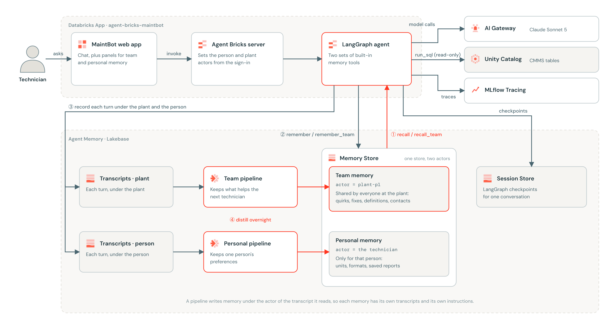
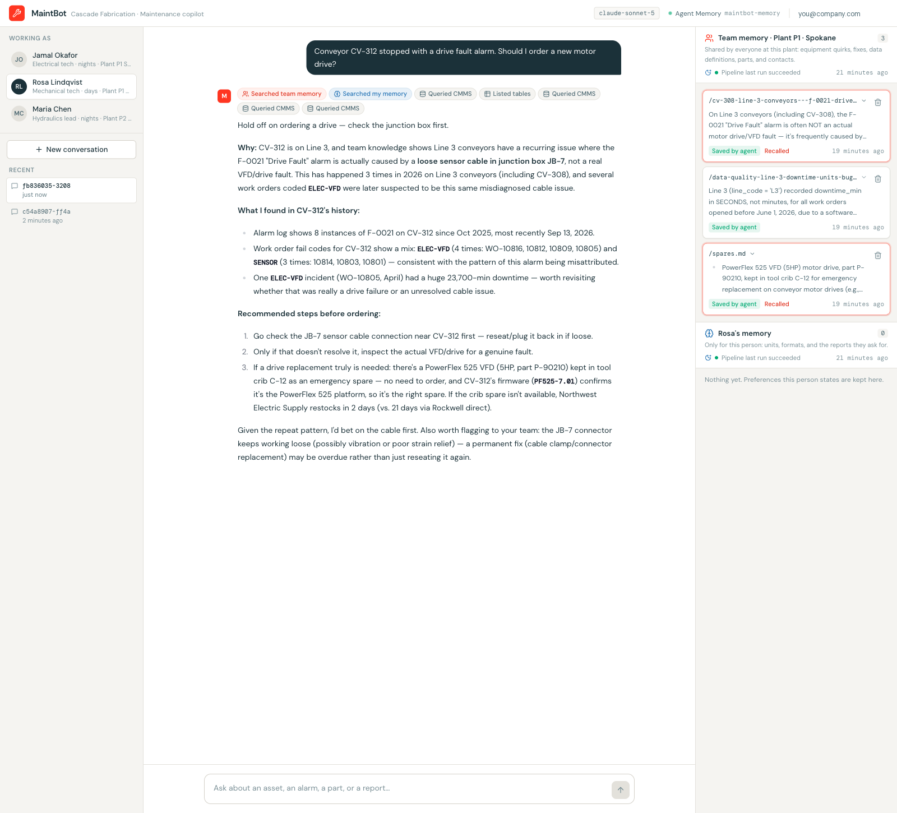

# MaintBot: a maintenance copilot with Agent Memory

Code accompanying the Databricks blog post **"Build a maintenance copilot with Agent Memory"**
(link added once the post is live).

MaintBot is a LangGraph agent for plant technicians, built with the
[Agent Bricks CLI](https://docs.databricks.com/aws/en/agents/custom-agents/agent-bricks-cli) and
[Agent Memory on Databricks](https://docs.databricks.com/aws/en/agents/agent-memory/managed-memory).
It answers questions over a plant's maintenance data (CMMS tables in Unity Catalog) and learns from
every shift: what one technician explains at night is there for the next technician in the morning,
without anyone writing it down.

On the night shift, Jamal finds that a conveyor stopped with a drive fault alarm because a sensor
cable in junction box JB-7 had worked loose, not because the drive failed. Overnight, a memory
pipeline distills that conversation into the plant's team memory. On the day shift, Rosa asks whether
she should order a new drive for a different conveyor and is told to check the junction box first.





All data in this project is synthetic and generated by `setup/generate_data.py`. Cascade Fabrication,
its plants, and its technicians are fictional.

## How it works

MaintBot keeps two memories in one Agent Memory store, told apart by **actor**:

| Memory | Actor | Holds | Example |
|---|---|---|---|
| Team memory | the plant, e.g. `plant-p1` | Equipment quirks, fixes, data definitions, parts, vendors, contacts | "When a Line 3 conveyor stops with a drive fault alarm, check the sensor cable in junction box JB-7 first" |
| Personal memory | the signed-in technician | Units, formats, saved reports, the line they cover | "Procedures as short checklists, lockout/tagout first" |

Knowledge reaches memory two ways, both built in:

- **During a conversation**, the agent saves what it's told with the built-in memory tools. It has two
  sets: `remember`, `recall`, `forget`, `list_memories` for personal memory, and the same tools renamed
  `*_team` for team memory.
- **After the shift**, two memory pipelines read the transcripts and distill what's durable. A pipeline
  writes memory under the actor of each transcript it reads, so MaintBot records every turn twice:
  under the plant (for the team pipeline) and under the person (for the personal pipeline). Each
  pipeline has its own instructions.

| Piece | Declared in | What it does |
|---|---|---|
| Memory Store `maintbot-memory` | `agent.toml` | Team and personal memory, partitioned by actor |
| Session Store `maintbot-sessions` | `agent.toml` | LangGraph checkpoints for each conversation |
| Transcript stores `maintbot-team-transcripts`, `maintbot-transcripts` | `app.yaml` | Plain turns under the plant and under the person |
| Memory pipelines | `setup/pipeline_instructions_*.md` | Distill transcripts into team and personal memory |
| Agent | `agent/agent.py` | Two memory tool sets, transcript capture, session ownership |
| Identity | `runtime/identity.py` | Derives the person and plant actors from the signed-in user |
| Web app | `client/`, `runtime/api.py` | Chat, plus team and personal memory panels |

## Getting started

Prerequisites:

- A Databricks workspace with Agent Bricks and Agent Memory (Beta). A workspace admin turns on
  **Agent Memory Sessions** from the Previews page.
- Permission to create Databricks Apps
- A serverless SQL warehouse and a Unity Catalog schema you can create tables in
- [uv](https://docs.astral.sh/uv/) and Node.js 20 or later

**1. Install the CLI and get the code**

```bash
uv tool install databricks-agentbricks
git clone https://github.com/databricks-solutions/databricks-blogposts.git
cd databricks-blogposts/2026-11-maintenance-copilot-agent-memory
```

**2. Configure.** Copy `.env.example` to `.env`, then set `DATABRICKS_CONFIG_PROFILE`, `CMMS_SCHEMA`
(`<catalog>.<schema>`), and `CMMS_WAREHOUSE_ID`.

**3. Load the plant data**

```bash
uv run python setup/generate_data.py
uv run python setup/load_data.py
```

**4. Create the stores and the memory pipelines**

```bash
agentbricks memory stores create --display-name maintbot-memory
agentbricks sessions stores create --name maintbot-sessions
agentbricks sessions stores create --name maintbot-team-transcripts
agentbricks sessions stores create --name maintbot-transcripts

agentbricks memory pipeline create --display-name maintbot-team-memory \
  --session-store maintbot-team-transcripts --memory-store maintbot-memory \
  --model system.ai.claude-sonnet-5 --trigger scheduled \
  --instructions @setup/pipeline_instructions_team.md
agentbricks memory pipeline create --display-name maintbot-personal-memory \
  --session-store maintbot-transcripts --memory-store maintbot-memory \
  --model system.ai.claude-sonnet-5 --trigger scheduled \
  --instructions @setup/pipeline_instructions_personal.md
```

`--model` is optional; without it a pipeline uses a default model. Scheduled pipelines run about every
24 hours. Put the pipeline IDs in `.env` and `app.yaml` as `MAINTBOT_TEAM_PIPELINE_ID` and
`MAINTBOT_PIPELINE_ID`, and the CMMS values in `app.yaml`.

**5. Give the plants some history** (optional)

```bash
uv run python setup/seed_conversations.py
agentbricks memory pipeline run <team-pipeline-id>
agentbricks memory pipeline run <personal-pipeline-id>
```

**6. Run locally**

```bash
uv run uvicorn runtime.main:app --port 8765    # then open http://localhost:8765
```

The built web app is included in `client/dist`. To change the UI, run `npm install` and `npm run dev`
in `client/` (port 5173, proxied to the API on 8765), then `npm run build`.

**7. Deploy**

```bash
agentbricks deploy
```

`deploy` creates the app, wires in the stores declared in `agent.toml`, and grants the app access to
them. Grant the app's service principal the rest yourself:

- `WRITE` on both transcript stores, for example
  `AgentKitClient(w).session_stores.get("maintbot-team-transcripts").grant_permission(<sp-client-id>)`
- `USE CATALOG`, `USE SCHEMA`, and `SELECT` on the CMMS schema
- `CAN USE` on the SQL warehouse

**8. Measure it** (optional)

```bash
uv run python -m eval.run_eval --label after-pipelines --repeats 3
uv run python -m eval.report after-pipelines
```

Each eval question runs in a fresh conversation, with and without memory, and a judge model grades the
answer against a rubric. Memory is read-only during the eval, so grading can't change what's measured.

## Costs

During the Beta, Agent Memory itself has no added charge: you pay for the Lakebase instance that stores
the memory entries. Memory pipeline runs are billed for serverless compute and for the model calls that
distill memory. Pricing may change.

## Design notes

- **Pick the actor by who should share the knowledge.** An equipment quirk belongs to the plant; a
  preference belongs to the person. Both actors come from the signed-in user on the server, never from
  the model or the request body.
- **Use a separate store where knowledge must not cross.** The store is the security boundary: anyone
  with access to a store can read every actor in it.
- **Give each memory its own pipeline instructions,** and review what each pipeline writes before you
  schedule it.
- **Check who owns a session before resuming it.** The LangGraph saver resumes an existing session by ID
  without checking its actor, so `run_agent` verifies ownership first.
- **Serialize memory writes.** Models often call `forget` and `remember` on the same topic in one step,
  and memory writes aren't atomic, so MaintBot runs them one at a time.

## Project layout

```text
agent/     LangGraph agent and CMMS tools
runtime/   Agent Bricks server, trusted-actor middleware, web app API
client/    React + Vite + Tailwind web app (built output in client/dist)
setup/     Synthetic CMMS data, seed conversations, pipeline instructions
eval/      Fresh-session eval with and without memory
tests/     Hermetic tests: uv run pytest
```

## Libraries

| Library | License |
|---|---|
| databricks-agentbricks, databricks-agents | Databricks License |
| databricks-sdk, databricks-langchain | Apache 2.0 |
| langgraph, langchain, mcp | MIT |
| uvicorn, python-dotenv | BSD 3-Clause |
| react, react-dom, react-markdown, remark-gfm, zustand, axios, animejs, clsx, tailwind-merge, @heroicons/react | MIT |
| vite, @vitejs/plugin-react, tailwindcss, @tailwindcss/typography, postcss, autoprefixer, eslint, typescript-eslint | MIT |
| typescript | Apache 2.0 |

## Support

This content is provided as an example for educational purposes and is not covered by Databricks
support. For questions or bugs, open a GitHub issue and the authors will help on a best-effort basis.

Maintainers: Ankit Yadav and Prashant Upadhyay.

© 2026 Databricks, Inc. All rights reserved. The source in this folder is provided subject to the
Databricks License ([LICENSE.md](LICENSE.md)).
